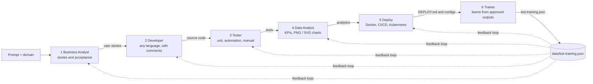
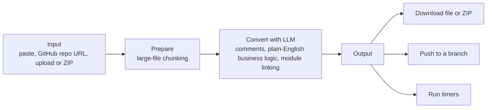

# BOT: Agentic AI Chatbot

**Try BOT live:** https://bot-code-converter.onrender.com (home `/`, converter `/convert`, 6 stages `/stages`)


BOT is a Spring Boot / Java 17 app with a **repo-scale code converter** and a **6-stage AI pipeline** (Business Analyst, Developer, Tester, Data Analyst, Deploy, Trainer) for any domain and any language. It runs on a local Ollama model or any OpenAI compatible API. Home keeps **Previous results** from converter and Stage bots requests.

## Workflow


### 6-stage pipeline (`/stages`)



Each stage is independent or chainable, and **Run all** executes the whole chain. You approve the outputs you like, and the Trainer stores them so later runs follow your examples.

### Code converter (`/convert`)



### Home (`/`)

Flash-card landing for Code converter and Stage bots. The sidebar **Previous results** list keeps converter jobs and six-stage runs so you can open them again.

## Features

- **Business Analyst:** user stories for any of 39 domains, with a domain sample requirement.
- **Developer:** code in any of 57 languages, with comments.
- **Tester:** JUnit, pytest or Jest unit tests, plus Selenium (Java or Ruby) automation.
- **Data Analyst:** KPIs, `analytics/STATS.md`, Chart.js `dashboard.html` and `metrics.json`. Download each graph as PNG or SVG on a white background.
- **Deploy:** Dockerfile, CI/CD pipeline, Kubernetes manifests and `DEPLOY.md`.
- **Trainer:** learns from approved outputs, stored in `data/bot-training.json`.
- **Previous results:** converter and Stage bots requests are saved on Home and open the matching job or run.
- **MCP + Guardrails:** agents call `POST /api/mcp` (`tools/list`, `tools/call`) for stages and GitHub push; every call is checked by guardrails (block secrets, protect `main`/`master`, allowlist `github.com`).
- **Code converter:** paste code, give a GitHub repo URL, or upload a file or ZIP. Handles large files by chunking, adds comments, explains business logic in plain English, and links modules. Download a file or ZIP, push to a branch, and see run timers.

### MCP + Guardrails

```http
POST /api/mcp
Content-Type: application/json

{"jsonrpc":"2.0","id":1,"method":"tools/list","params":{}}
```

Tools: `run_stage`, `run_all_stages`, `push_run`, `test_github_token`, `get_run_status`, `list_stages`.  
Optional header `X-BOT-MCP-Key` when `BOT_MCP_API_KEY` is set.  
Guardrail mode: `BOT_GUARDRAIL_MODE=ENFORCE` (default) or `OBSERVE`.

## Pages

| URL | What it does |
|-----|--------------|
| `/` | Home: Code converter and Stage bots, Previous results |
| `/convert` | Code converter |
| `/stages` | 6-stage pipeline, run each stage or Run all |
| `/api/mcp` | MCP JSON-RPC for agents (tools + guardrails) |

## Run locally

Requirements: **JDK 17+** and **Maven 3.9+**.

```powershell
mvn clean package
java -jar target/agentic-ai-chatbot-1.0.0.jar
```

Or run `.\scripts\run-web.ps1`. Then open <http://localhost:8080>.

### Model

- **Local Ollama (default):** install [Ollama](https://ollama.com) and pull the model:

  ```powershell
  ollama pull qwen2.5-coder:1.5b
  ```

  Set `CONVERTER_MODEL` to choose another installed model. When it is blank, BOT picks the largest installed coding model.
- **OpenAI compatible API:** set `OPENAI_API_KEY` (optional `OPENAI_BASE_URL`, `OPENAI_MODEL`, default `gpt-4o-mini`).
- With neither, BOT falls back to built-in templates and samples.

| Variable | Purpose |
|----------|---------|
| `OPENAI_API_KEY` | Enables OpenAI mode |
| `OPENAI_BASE_URL` | Default `https://api.openai.com/v1` |
| `OPENAI_MODEL` | Default `gpt-4o-mini` |
| `LLM_ENABLED` | `true` or `false` |
| `OLLAMA_URL` | Default `http://localhost:11434` |
| `CONVERTER_MODEL` | Ollama model for the converter |
| `GITHUB_TOKEN` | Optional, for private repos and pushing |

## Share it publicly

```powershell
.\scripts\start-public.ps1
```

Starts BOT in safe public mode (local folder input and push-to-branch are blocked, visitors only see their own jobs) and a free Cloudflare quick tunnel, then prints a `https://<random>.trycloudflare.com` link. Share `<link>/convert` or `<link>/stages`. The link changes each time the tunnel restarts, and the laptop must stay on.

For a permanent link, deploy to Render with `render.yaml` and the `Dockerfile`. See [docs/HOSTING.md](docs/HOSTING.md).

## Project layout

```text
agentic-ai-chatbot/
├── src/main/java/com/agentic/chatbot/   # agents, generators, converter, web controllers
├── src/main/resources/                  # templates, static assets, code samples, application.yml
├── scripts/                             # run-web, start-public, pipeline helpers
├── docs/                                # workflow.svg, HOSTING.md, guides
├── data/bot-training.json               # approved training examples
├── Dockerfile, render.yaml              # hosting
└── pom.xml
```

## REST API

- `POST /api/pipeline`: run the chat pipeline.
- `POST /api/stages/{stage}`, `POST /api/stages/run-all`: run one stage or all stages.
- `POST /api/stages/{stage}/approve`: approve an output for the Trainer.
- `POST /api/convert/jobs`: start a repo or file conversion job (download, ZIP and push endpoints live under `/api/convert/jobs/{id}`).
